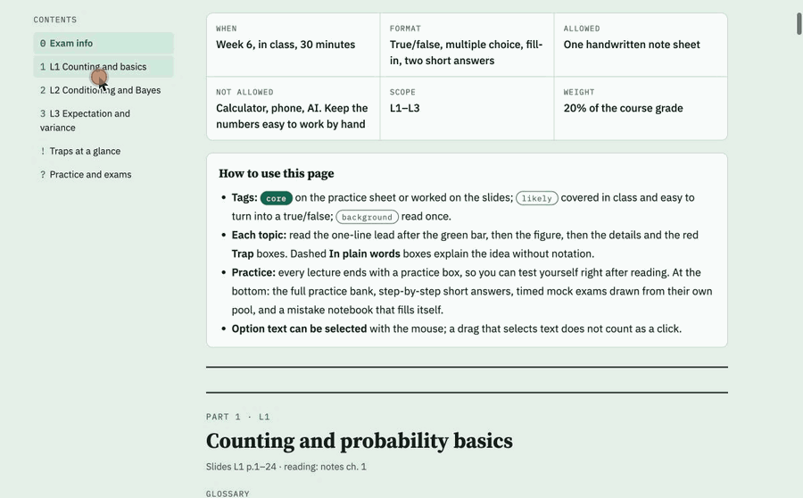
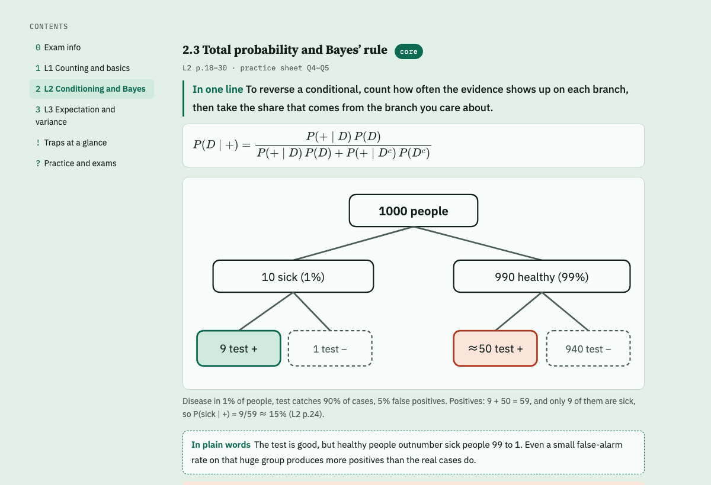
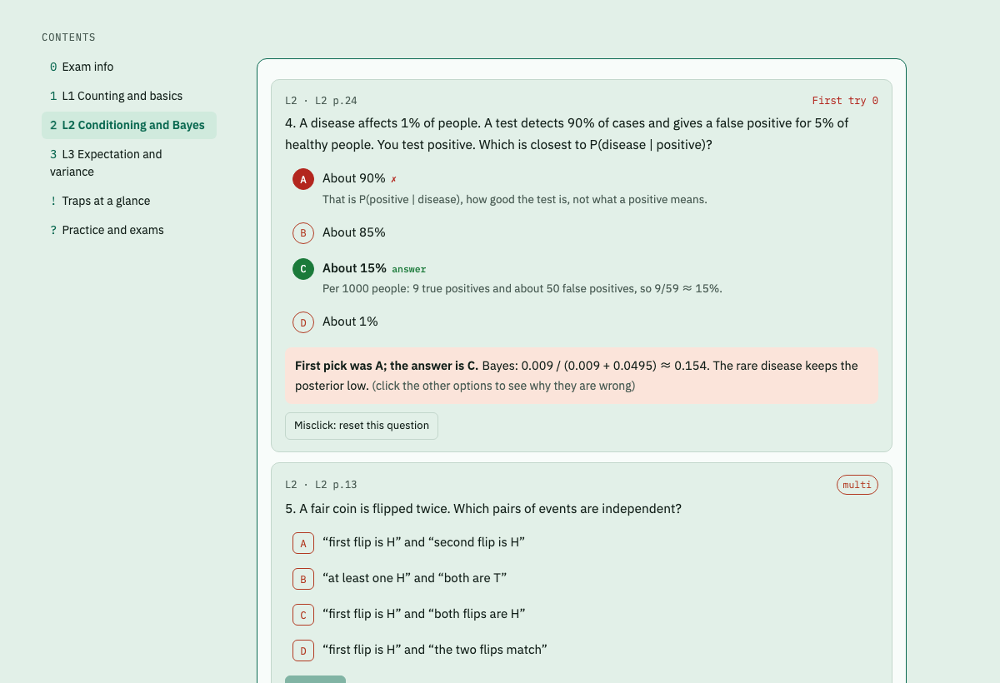
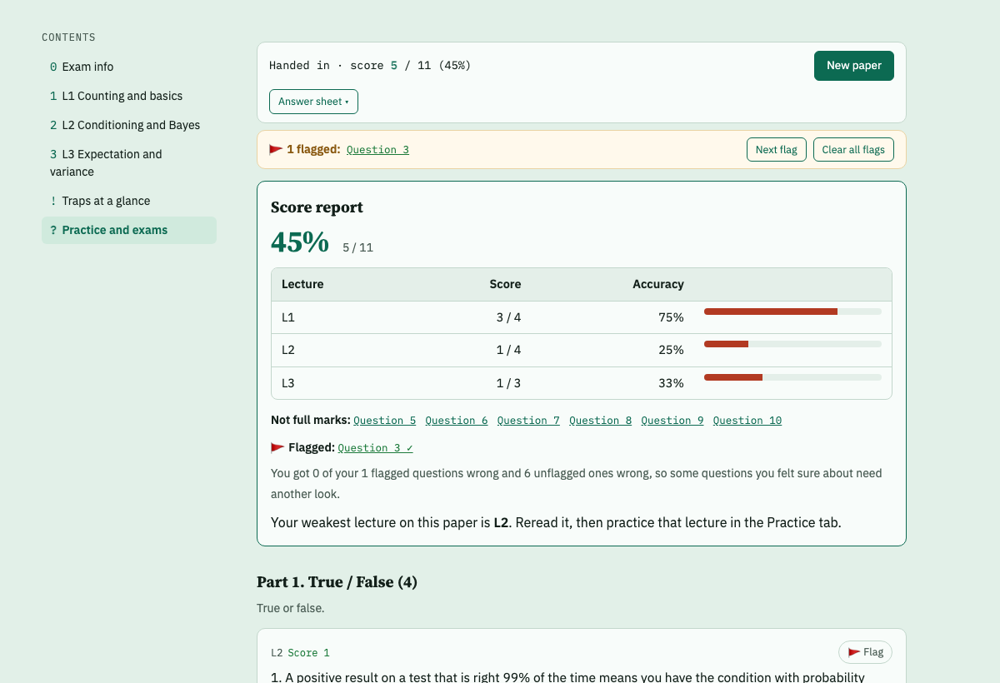

# study-guide

Turn your course slides into an **interactive exam review page**. Then export how you answered, and your agent writes new drills for your weak spots.

An [Agent Skill](https://agentskills.io) for Claude Code and Codex; other agents that support Agent Skills should work too.

**Installing, for people and AI agents:** the skill is the folder [`skills/study-guide`](skills/study-guide), not the whole repository. Copy that folder into your agent's skills folder (for example `~/.claude/skills/` or `~/.agents/skills/`) so that `SKILL.md` sits directly in `.../skills/study-guide/`. Cloning the whole repository into the skills folder puts `SKILL.md` two levels too deep, and the skill won't show up.

**▶ [Live demo](https://rzhang569.github.io/study-guide/)** (a fictional intro probability course; your answers stay in your own browser) · v0.1.0, early release, feedback welcome

> **New to Claude or Codex, or never used a terminal?** Follow the step-by-step [getting started guide](docs/GETTING-STARTED.md) · [中文新手指南](docs/GETTING-STARTED.zh.md). It covers installing the app, Python and the skill (or letting the AI install it), connecting your browser for Canvas, and your first page.



## Quick start

The easiest way, in Claude Code or Codex: send your agent one message, with your own course details.

> Install this skill for me so I can use it in every project: https://github.com/rzhang569/study-guide. Then read its SKILL.md and use it right away to make me a review page: my BIO 201 midterm is next Tuesday, it covers lectures 1–8, multiple choice plus two short answers. The slides are in this folder; if they aren't, get them yourself if you can.

Or install it yourself. Claude Code:

```bash
claude plugin marketplace add rzhang569/study-guide
claude plugin install study-guide@study-guide
```

Codex:

```bash
d=$(mktemp -d) && git clone https://github.com/rzhang569/study-guide.git "$d/study-guide" && mkdir -p ~/.agents/skills && cp -R "$d/study-guide/skills/study-guide" ~/.agents/skills/
```

Then, in a new chat, ask your agent: *"my BIO 201 midterm covers lectures 1–8, here are the slides, make me a review page."* Other agents are under [Install](#install).

## What you get

One HTML file with:

- **Notes by lecture**, every claim citing a slide page ("L7 p.23"), with a glossary, examples before formulas, plain-language boxes, figures and trap boxes.
- **Practice everywhere**: a box at the end of each section, plus a full bank with an explanation for **every** option, partial credit on multi-select, and fill-ins graded by value (`1/2`, `0.5` and `50%` all count).
- **Step-by-step short answers** that mirror the exam's long questions, with points per step.
- **Timed mock exams** from a separate pool, in the real exam's proportions, with an answer sheet, flags, auto-submit and a score report by lecture.
- **A mistake notebook and a progress report.** Your agent reads the report back and writes new questions that re-ask your weak concepts in different words.

| Notes | Practice | Mock exam report |
|---|---|---|
|  |  |  |

The demo course in [`skills/study-guide/examples/demo`](skills/study-guide/examples/demo) is fictional (three lectures of intro probability). Build it locally with `python3 skills/study-guide/scripts/build.py skills/study-guide/examples/demo` and open the `review.html` it writes.

## What's different

- **The agent does the research.** It reads the course schedule, syllabus and posted quiz results, and looks for patterns. An example: "checkpoint quiz questions come right after a specific slide".
- **The mock exam is calibrated without spoilers.** `count_exam.py` measures a sample exam's size and structure without printing any question, so you can still save the real sample for one timed run.
- **The loop closes.** The page keeps a compact progress report. Copy it out with the **Export progress** button and paste it to your agent, which turns it into targeted drills and rewrites the explanations you misread. When the page runs as a Claude artifact it also tries to sync the report automatically (experimental).
- **The question banks are audited.** The build warns when the correct answer is usually the longest option, when one letter is the shown answer too often, when every multi-select has the same number of answers, when true/false leans one way, or when a mock question looks like a practice question with new numbers. Warnings point at problems; the author still has to fix them.

## Install

The skill is the folder `skills/study-guide`. Every agent below loads it from a skills folder; only the folder differs. All of them need Python 3 to build pages (`python3`; on Windows often `python` or `py -3`), and `count_exam.py` also needs `pypdf`.

**Claude Code (tested), as a plugin:**

```bash
claude plugin marketplace add rzhang569/study-guide
claude plugin install study-guide@study-guide
```

Inside a session the commands are `/plugin marketplace add rzhang569/study-guide`, then `/plugin install study-guide@study-guide`. Or install it as a plain skill: copy `skills/study-guide` to `~/.claude/skills/study-guide`.

**Codex (tested on macOS), Gemini CLI, Cursor and GitHub Copilot in VS Code (documented, not tested end to end):** all four read skills from `~/.agents/skills/`, so one copy serves them all:

```bash
d=$(mktemp -d) && git clone https://github.com/rzhang569/study-guide.git "$d/study-guide" && mkdir -p ~/.agents/skills && cp -R "$d/study-guide/skills/study-guide" ~/.agents/skills/
```

- **Codex** (the Codex mode of the ChatGPT desktop app, the CLI and the IDE extension) also reads `.agents/skills/` inside a repository. To call it explicitly, type `@` and pick it in the app, or `$study-guide` in the CLI. Asking Codex to install the skill from this repository's URL also works; its built-in installer puts it in `~/.codex/skills/`.
- **Gemini CLI** can install straight from GitHub: `gemini skills install https://github.com/rzhang569/study-guide.git --path skills/study-guide`. Gemini CLI was succeeded by Antigravity CLI in June 2026; Antigravity's skill folders are not confirmed here.
- **Cursor** also reads `~/.cursor/skills/` and `~/.claude/skills/`. Importing from GitHub inside Cursor needs a Cursor plugin package, which this repository doesn't have yet.
- **GitHub Copilot**: VS Code local sessions also read `~/.copilot/skills/`; for one repository, use `.github/skills/`. Copilot's cloud agent can't see a skill installed on your computer.

**claude.ai (experimental, not yet tested):** zip the `skills/study-guide` folder and upload it in the Skills section of claude.ai settings. Code execution must be on. Pages published as artifacts try to sync progress through the artifact database; if that doesn't work for you, use Export progress.

**Other agents:** any agent that supports the [Agent Skills](https://agentskills.io) format and can run scripts should be able to load `skills/study-guide`; put it wherever that agent looks for skills.

### What has been tested

v0.1.0 is an early release; issues and feedback are welcome.

- **Tested:** building pages; using them locally in a browser; the Export progress → paste to Claude loop; installing the Claude Code plugin from GitHub; Codex CLI and the Codex app on macOS (calling `$study-guide`, and picking the skill on its own in a new chat); Claude Code on Windows (asking it to install the skill, finding it under `/` in a new chat, building a page and opening it by double-click); a small with/without-skill comparison of an earlier version (see [Evaluation](#evaluation)).
- **Documented by each agent but not tested end to end:** Gemini CLI, Cursor and GitHub Copilot.
- **Experimental, not yet tested end to end:** uploading to claude.ai; automatic progress sync when the page runs as a Claude artifact; whether agents other than Codex pick the skill on their own in a normal conversation.

## Use

Talk to your agent normally:

- "Midterm next Tuesday, lectures 1–8, T/F + MC + short answers, no calculator. Slides are in `./slides`. Build me a review page."
- "Here's the sample exam PDF, but don't read it, I want to take it timed. Just match the mock exam to it."
- "Here's my exported progress. What should I review, and can you add drills for it?"

Under the hood, the skill keeps each exam in a plain folder and builds it with one command (Python 3, standard library):

```text
my-course/
  course.json      title, language (en/zh), lectures, mock exam layout and time limits
  sections/        one HTML file per lecture
  practice.json    practice bank
  mock.json        mock exam pool (its own questions)
  short.json       step-by-step short answers (optional)
```

```bash
python3 skills/study-guide/scripts/build.py --init my-course   # start from the demo
python3 skills/study-guide/scripts/build.py my-course          # check + write my-course/review.html
```

The interface comes in English and Chinese (`"lang": "en"` / `"zh"`). Write the content in whatever language you study in.

## Academic integrity

The page is for studying, not for graded work. The skill checks the course's AI policy first and never puts homework answers on the page. It only reads a sample exam you want to save if you say so, and even then it uses it for calibration only. Don't publish pages that contain your course's copyrighted material (slides, official questions); keep them private.

## Layout

```text
.claude-plugin/          plugin + marketplace manifests
skills/study-guide/
  SKILL.md               the workflow the agent follows
  references/            content standard, question-bank rules, data format
  assets/                engine.js (the page's logic), page.css
  scripts/               build.py (check + build), count_exam.py (spoiler-free exam measurement)
  examples/demo/         a complete small course (build it to see the page)
evals/                   test cases (prompts, fictional inputs, graders) and results
tests/                   Python and Node regression suites (see Tests)
```

## Tests

Run from the repository root (Python 3 and Node.js 20+; no npm dependencies):

```bash
python3 -m unittest -v
node --test
node tests/browser/run.mjs   # real headless Chrome; prints SKIP if no Chrome is found
```

The suites cover course validation/builds, grading, timers, saved progress, and the
Export progress contract. See [the rule audit and test notes](tests/README.md).
The existing PDF test skips when its optional `pypdf` dependency is unavailable.
`python tests/install_docs.py` pastes the manual install commands from the [getting started guide](docs/GETTING-STARTED.md) into bash (on Ubuntu in CI, standing in for the Mac commands) or into Windows PowerShell 5.1 and PowerShell 7, installing into a temporary home folder, and checks that the installed copies match the repository and build. It clones this checkout rather than the public URL, and doesn't cover the plugin install, the ZIP route or whether an agent app then finds the skill.

## Evaluation

[`evals/`](evals) holds three test cases with fictional inputs: building a page from slides, describing a sample exam without reading it, and writing drills from a progress export. In a first round (2026-10-22), each case ran once with the skill and once without it on claude-opus-5-5, and independent agents graded the results. This round tested an earlier version of the skill (commit `e980bb9`):

| | With the skill | Without the skill |
|---|---|---|
| Assertions passed, as first written | 18/19 | 16/19 |
| Same outputs, re-graded with the revised assertions | 16/20 | 15/20 |

This is a small early check, not proof. It used one run per configuration and tested the version before the changes below. Under the revised assertions, the two configurations differ by a single assertion: whether every practice option is explained. They shared weaknesses:
- mock questions that were practice questions with new numbers;
- reading some question content while measuring a sample exam.

Since then:
- `count_exam.py` reports more of an exam's structure and has regression tests;
- the build warns about lopsided answer letters and about number-swapped mock questions.

These changes have not been re-evaluated yet. Details are in [`evals/README.md`](evals/README.md).

## License

MIT

---

**中文简介（v0.1.0 早期版本）：** 一个 Agent Skill。把课程的 PPT、笔记整理成交互式复习网页：内容按讲组织，每条结论都标出处；练习题的每个选项都有解析；简答题按步骤给分；模拟考试用单独的题库，按真考比例抽题、计时；错题本自动收集错题。导出的作答记录交给你用的 AI 编程助手（Claude Code、Codex 等），它会找出薄弱点，再出针对性的新题。界面支持中文和英文（`"lang": "zh"`）。第一次用？看[中文新手指南](docs/GETTING-STARTED.zh.md)。
