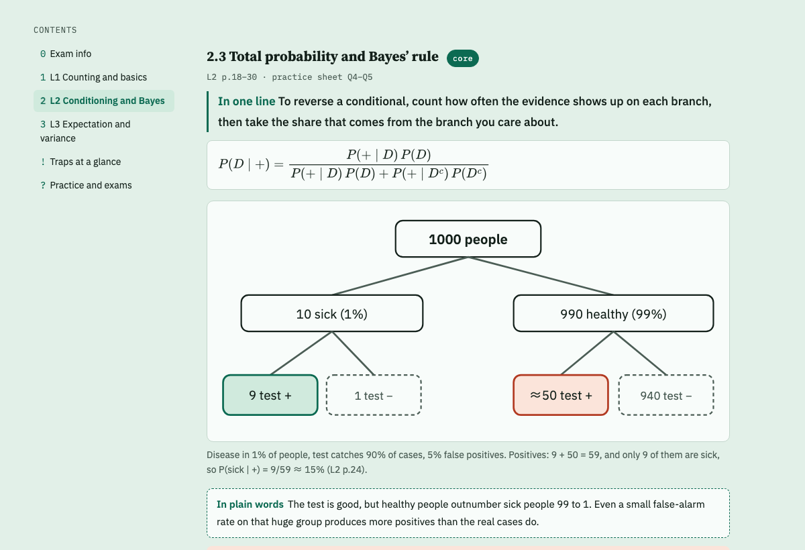
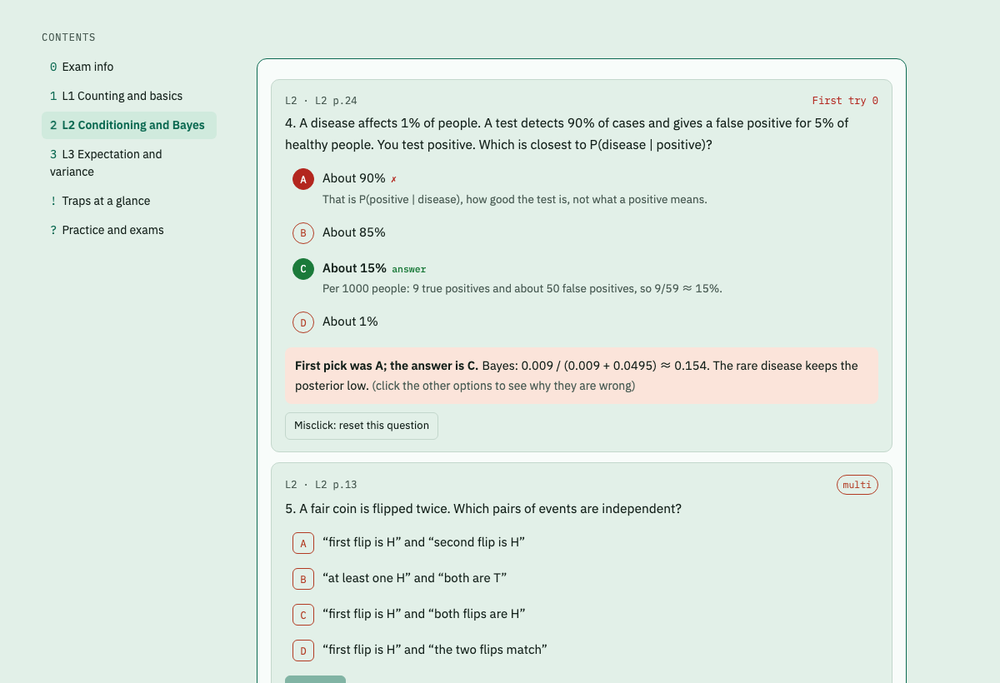
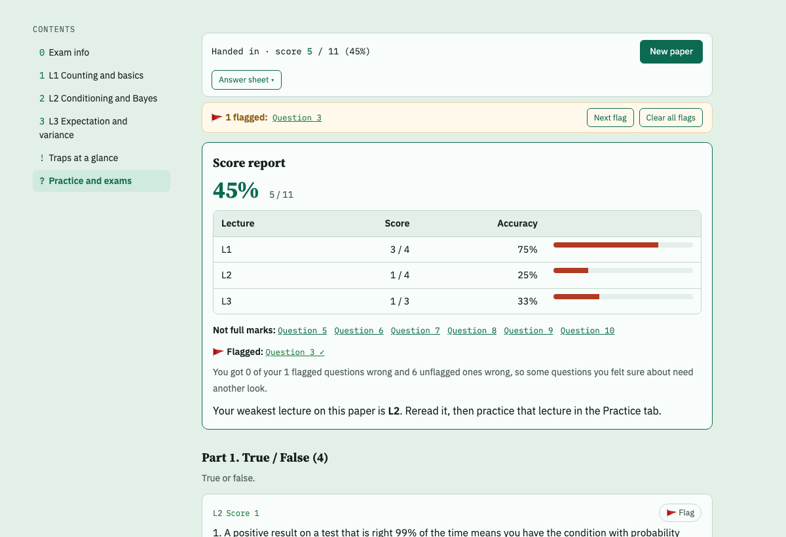

# study-guide

An [Agent Skill](https://agentskills.io) that turns a course's slides and notes into an **interactive exam review page**, and then keeps improving it from how you actually answer.

**Live demo: <https://rzhang569.github.io/study-guide/>** (a fictional intro probability course; your answers are saved only in your own browser)

> **Status: v0.1.0, early release.** Feedback and issues are welcome.
>
> - **Tested:** building pages; using them locally in a browser; the Export progress → paste to Claude loop; installing the Claude Code plugin from GitHub; a small with/without-skill comparison of an earlier version (see [Evaluation](#evaluation)).
> - **Experimental, not yet tested end to end:** uploading to claude.ai; automatic progress sync when the page runs as a Claude artifact; other agents; whether Claude picks the skill on its own in a normal conversation.



Ask Claude something like *"my BIO 201 midterm covers lectures 1–8, here are the slides, make me a review page"*. You get one HTML file with:

- **Notes by lecture.** Every claim cites a slide page ("L7 p.23"). Each lecture has a glossary, one-line leads, concrete examples before formulas, "in plain words" boxes, figures and red trap boxes for what true/false questions twist.
- **A practice box at the end of every section**, so you test yourself right after reading instead of after five lectures.
- **A practice bank** with instant feedback, an explanation for **every** option, partial credit on multi-select, and fill-ins graded by value (`1/2`, `0.5` and `50%` all count).
- **Step-by-step short answers** that mirror the exam's long questions, with points per step.
- **Timed mock exams** drawn from a **separate pool** in the real exam's proportions. They have an answer sheet, flags for questions you're unsure about, auto-submit, and a score report by lecture.
- **A mistake notebook** that collects first-try misses and wrong or flagged mock questions.
- **A progress report** Claude reads back. It names your weak spots and writes new questions that re-ask the same concept in different words, not the same question again.

| Practice with per-option explanations | Mock exam report |
|---|---|
|  |  |

The demo course in [`skills/study-guide/examples/demo`](skills/study-guide/examples/demo) is fictional (three lectures of intro probability). Try it at the [live demo](https://rzhang569.github.io/study-guide/), or open its `review.html` locally.

## What's different

- **Claude does the research.** It reads the course schedule, syllabus and posted quiz results, and looks for patterns. An example: "checkpoint quiz questions come right after a specific slide".
- **The mock exam is calibrated without spoilers.** `count_exam.py` measures a sample exam's size and structure without printing any question, so you can still save the real sample for one timed run.
- **The loop closes.** The page keeps a compact progress report. Copy it out with the **Export progress** button and paste it to Claude, which turns it into targeted drills and rewrites the explanations you misread. When the page runs as a Claude artifact it also tries to sync the report automatically (experimental).
- **The question banks are audited.** The build warns when the correct answer is usually the longest option, when one letter is the shown answer too often, when every multi-select has the same number of answers, when true/false leans one way, or when a mock question looks like a practice question with new numbers. Warnings point at problems; the author still has to fix them.

## Install

**Claude Code (plugin):**

```bash
claude plugin marketplace add rzhang569/study-guide
claude plugin install study-guide@study-guide
```

Inside a session the commands are `/plugin marketplace add rzhang569/study-guide`, then `/plugin install study-guide@study-guide`.

**Claude Code (plain skill):** copy `skills/study-guide` to `~/.claude/skills/study-guide`.

**claude.ai (experimental, not yet tested):** zip the `skills/study-guide` folder and upload it in the Skills section of claude.ai settings. Code execution must be on. Pages published as artifacts try to sync progress through the artifact database; if that doesn't work for you, use Export progress.

**Other agents (not yet tested):** any agent that supports the Agent Skills format should be able to load `skills/study-guide` directly.

## Use

Talk to Claude normally:

- "Midterm next Tuesday, lectures 1–8, T/F + MC + short answers, no calculator. Slides are in `./slides`. Build me a review page."
- "Here's the sample exam PDF, but don't read it, I want to take it timed. Just match the mock exam to it."
- "Here's my exported progress. What should I review, and can you add drills for it?"

Under the hood, the skill keeps each exam in a plain folder and builds it with one command (Python 3, standard library):

```text
my-course/
  course.json      title, language (en/zh), lectures, mock exam layout and time limits
  sections/        one HTML file per lecture
  practice.json    practice bank
  mock.json        mock exam pool (its own questions)
  short.json       step-by-step short answers (optional)
```

```bash
python3 skills/study-guide/scripts/build.py --init my-course   # start from the demo
python3 skills/study-guide/scripts/build.py my-course          # check + write my-course/review.html
```

The interface comes in English and Chinese (`"lang": "en"` / `"zh"`). Write the content in whatever language you study in.

## Academic integrity

The page is for studying, not for graded work. The skill checks the course's AI policy first and never puts homework answers on the page. It only reads a sample exam you want to save if you say so, and even then it uses it for calibration only. Don't publish pages that contain your course's copyrighted material (slides, official questions); keep them private.

## Layout

```text
.claude-plugin/          plugin + marketplace manifests
skills/study-guide/
  SKILL.md               the workflow Claude follows
  references/            content standard, question-bank rules, data format
  assets/                engine.js (the page's logic), page.css
  scripts/               build.py (check + build), count_exam.py (spoiler-free exam measurement)
  examples/demo/         a complete small course and its built page
evals/                   test cases (prompts, fictional inputs, graders) and results
tests/                   Python and Node regression suites (see Tests)
```

## Tests

Run from the repository root (Python 3 and Node.js 20+; no npm dependencies):

```bash
python3 -m unittest -v
node --test
```

The suites cover course validation/builds, grading, timers, saved progress, and the
Export progress contract. See [the rule audit and test notes](tests/README.md).
The existing PDF test skips when its optional `pypdf` dependency is unavailable.

## Evaluation

[`evals/`](evals) holds three test cases with fictional inputs: building a page from slides, describing a sample exam without reading it, and writing drills from a progress export. In a first round (2026-10-22), each case ran once with the skill and once without it on claude-opus-5-5, and independent agents graded the results. This round tested an earlier version of the skill (commit `e980bb9`):

| | With the skill | Without the skill |
|---|---|---|
| Assertions passed, as first written | 18/19 | 16/19 |
| Same outputs, re-graded with the revised assertions | 16/20 | 15/20 |

This is a small early check, not proof. It used one run per configuration and tested the version before the changes below. Under the revised assertions, the two configurations differ by a single assertion: whether every practice option is explained. They shared weaknesses:
- mock questions that were practice questions with new numbers;
- reading some question content while measuring a sample exam.

Since then:
- `count_exam.py` reports more of an exam's structure and has regression tests;
- the build warns about lopsided answer letters and about number-swapped mock questions.

These changes have not been re-evaluated yet. Details are in [`evals/README.md`](evals/README.md).

## License

MIT

---

**中文简介（v0.1.0 早期版本）：** 一个 Agent Skill。把课程的 PPT、笔记整理成交互式复习网页：内容按讲组织，每条结论都标出处；练习题的每个选项都有解析；简答题按步骤给分；模拟考试用单独的题库，按真考比例抽题、计时；错题本自动收集错题。导出的作答记录交给 Claude，它会找出薄弱点，再出针对性的新题。界面支持中文和英文（`"lang": "zh"`）。
